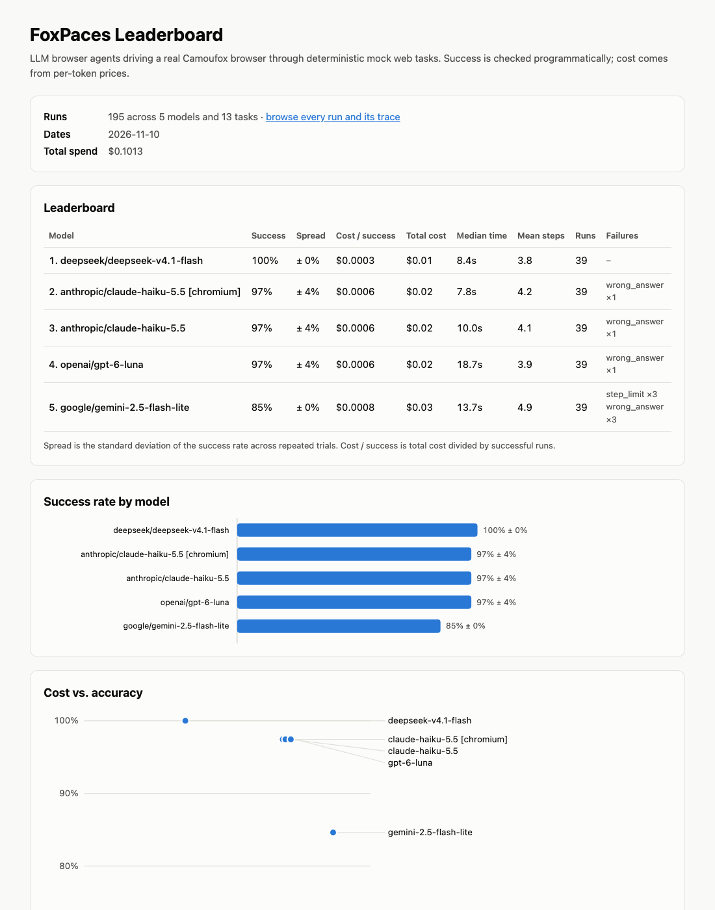

# FoxPaces

FoxPaces puts AI browser agents through their paces: a reproducible benchmark where LLM-driven agents drive a real [Camoufox](https://camoufox.com) (Firefox) browser to complete web tasks, scored on success, cost, speed, and steps.



People claim "my agent can browse the web", but there is rarely a small, honest, reproducible way to compare models on the same tasks with real cost numbers. FoxPaces is that harness: fixed tasks, programmatic success checks, every run traced, and real token costs.

## Results

| Model | Success | Spread | Cost / success | Median time | Mean steps |
|---|---|---|---|---|---|
| deepseek/deepseek-v4.1-flash | 100% | ± 0% | $0.0003 | 8.4s | 3.8 |
| anthropic/claude-haiku-5.5 [chromium] | 97% | ± 4% | $0.0006 | 7.8s | 4.2 |
| anthropic/claude-haiku-5.5 | 97% | ± 4% | $0.0006 | 10.0s | 4.1 |
| openai/gpt-6-luna | 97% | ± 4% | $0.0006 | 18.7s | 3.9 |
| google/gemini-2.5-flash-lite | 85% | ± 0% | $0.0008 | 13.7s | 4.9 |

195 runs (13 tasks × 3 trials per model), run on 2026-11-10 for $0.10 in total. `[chromium]` is the same model driving stock Playwright Chromium instead of Camoufox.

What the traces show: Gemini 2.5 Flash Lite types into the catalog search box but never submits it, then either counts the unfiltered first page (answers 5, not 3) or loops between a book and the list until the step limit (0/6 on the two catalog tasks). GPT-6 Luna once answered "placed" before finishing the checkout form. Haiku twice wrapped the birth date in a sentence instead of answering with the date only.

Full leaderboard with charts, per-task heatmap and a step-by-step trace for every run: `uv run foxpaces report` then open `site/index.html` (also deployed to GitHub Pages by `.github/workflows/pages.yml`).

## Methodology

- **Tasks.** 10 deterministic mock tasks served from this repo (`sites/`): search, a cart, a
  multi-step checkout, a contact form with a required consent checkbox, pagination, a login-
  protected dashboard, and a cookie banner that blocks clicks. 3 live read-only tasks on sites
  built for practice (books.toscrape.com, quotes.toscrape.com) and Wikipedia. No logins,
  form submissions or CAPTCHAs on live sites.
- **Success checks.** Each task declares one or more checks that must all pass: exact answer
  (case- and whitespace-insensitive), exact final URL, or a substring of the final page text.
  A model that claims success without completing the task fails.
- **Agent loop.** Each step the model sees the task, its previous steps (including its own
  short notes), and a compact snapshot of the page: URL, title, numbered interactive elements
  near the viewport, and the first 3,000 characters of visible text. It replies with one JSON
  action: `click`, `type`, `select`, `scroll`, `navigate`, `go_back`, or `done`.
  The prompt is stateless per step, which keeps cost linear in the number of steps.
- **Limits.** Per-task max steps, 60k tokens and 180 s per run, 3 s per browser action, three
  invalid replies in a row, and a USD budget per `foxpaces run` (`foxpaces.toml`).
- **Models.** All called through OpenRouter at temperature 0, with the same prompt. Cost is
  computed from the per-million-token prices in `foxpaces.toml`.
- **Repeats.** Every task runs 3 times per model. "Spread" is the standard deviation of the
  success rate across the 3 trials.
- **Failure categories.** `wrong_answer`, `step_limit`, `timeout`, `token_limit`,
  `invalid_action`, `browser_error`, `model_error`.

## Reproduce

```sh
uv sync
uv run python -m camoufox fetch
cp .env.example .env                      # add your OPENROUTER_API_KEY
uv run foxpaces run                       # scripted model: free, no key, what CI runs
uv run foxpaces run --repeats 3 --tasks "tasks/mock/*.toml" "tasks/live/*.toml" \
  --model anthropic/claude-haiku-5.5 --model openai/gpt-6-luna \
  --model deepseek/deepseek-v4.1-flash --model google/gemini-2.5-flash-lite
uv run foxpaces report                    # writes site/index.html
uv run pytest
```

Compare browsers with `--browser chromium` (run `uv run playwright install chromium` first).
Each run appends a row to `results/runs.jsonl` and writes its trace to
`results/traces/<run_id>.jsonl`.

## Limitations

- Small suite: 13 tasks, so one task moves a model's success rate by about 8 points.
- Only cheap models were run, to keep a full benchmark under $0.50.
- Text-only observations; no screenshots for vision models yet.
- Temperature 0 is not fully deterministic on every provider, which is why runs are repeated.
- Live tasks depend on third-party sites staying up and unchanged.
- The observation format and prompt are one design choice; other agent designs could rank
  models differently.

## Adding a task

Create a TOML file in `tasks/mock/` (or `tasks/live/`). `{mock}` is replaced with the local
mock-site server URL. The `solution` steps drive the free scripted model used in CI; `label`
targets an element by its visible label instead of an index.

```toml
id = "shop-blue-mug-price"
start_url = "{mock}/shop/index.html"
instruction = "Find the price of the Blue Mug. Answer with the price only, for example $1.00."
max_steps = 10

[success]
answer = "$12.50"
final_url = "{mock}/shop/product.html?id=blue-mug"

[[solution]]
action = "type"
label = "Search products"
text = "Blue Mug"

[[solution]]
action = "click"
label = "Blue Mug"

[[solution]]
action = "done"
answer = "$12.50"
```

## Adding a model

Any OpenRouter model works: add its price to `foxpaces.toml` and pass `--model <openrouter-id>`.
A new provider needs one class with `complete(messages) -> Completion` in
`src/foxpaces/models/` and one line in `src/foxpaces/models/factory.py`.

## Project layout

```
sites/               mock web apps (static HTML/JS)
tasks/mock, live/    task definitions (TOML)
src/foxpaces/        harness: agent loop, observation, actions, models, runner, CLI
src/foxpaces/report/ static leaderboard, runs list and trace viewer
results/             benchmark runs (JSONL) and traces
```
